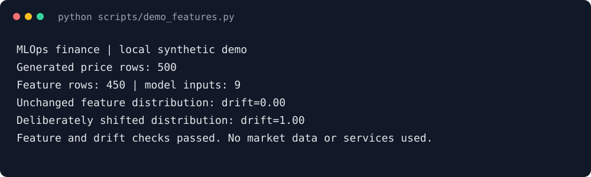
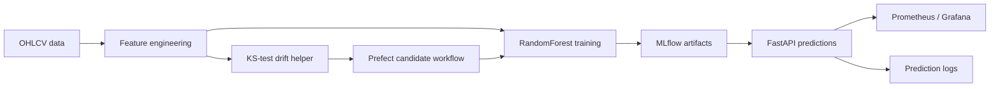

# mlops-finance — Financial Model Lifecycle Demo

[](https://github.com/redbarron23/mlops-finance/actions/workflows/ci.yml)
[](LICENSE)

**Explore how a financial model is trained, served, monitored, and evaluated for retraining.**
The prototype combines a RandomForest return model, FastAPI, MLflow, Prometheus/Grafana, and a
Prefect candidate-retraining flow. Its focus is MLOps mechanics, not trading performance.



## Quick start

Requirements: Python **3.10+**. Start with the local feature/drift demo; no market-data download,
cloud credentials, or running services are needed.

```bash
git clone https://github.com/redbarron23/mlops-finance.git
cd mlops-finance
python -m venv .venv
source .venv/bin/activate
python -m pip install -e ".[dev]"
python -m pytest tests/ -q
python scripts/demo_features.py
```

The demo builds features from generated prices and compares unchanged versus shifted feature
distributions with the existing drift helper. It does not train a trading model or run the services.

For the full local stack, run `docker compose up -d --build` and follow the
[service walkthrough](docs/guide.md#quick-start). The services expose MLflow on `:5000`, the API on
`:8000`, Prometheus on `:9090`, and Grafana on `:3000`.

## How it works



The code contains feature engineering, model training and tracking, prediction serving and logging,
feature-distribution tests, and candidate evaluation. The diagram shows these components; the
end-to-end integration still has the limits below.

## Quality and limits

- Default training generates **synthetic data** when `data/raw/` is empty. Historical market data
  can be supplied separately; it is not downloaded by the default training command.
- CI covers feature engineering and a deterministic local drift demo. It does not establish
  model accuracy or verify the full service/retraining stack.
- The training helper uses a random train/test split. A financial-model benchmark needs a
  time-based evaluation designed to prevent leakage; the current scores are demo results.
- The logged-drift path still needs feature-engineered reference data wired to the prediction
  logs. The local demo calls the drift helper directly with comparable feature columns.
- Serving loads a local MLflow artifact and caches it. Registry-stage selection and automatic
  model reload are not implemented; restarting after an artifact change clears the cache.
- Docker Compose uses local demo services and default Grafana credentials. Configure access and
  credentials before exposing the stack. This project is not a trading or production deployment recommendation.

## Documentation

| Topic | Guide |
| --- | --- |
| Services, training, predictions, and traffic replay | [Walkthrough](docs/guide.md#quick-start) |
| Detailed component map | [Architecture](docs/guide.md#architecture) |
| Modules and design choices | [Project structure](docs/guide.md#project-structure), [key decisions](docs/guide.md#key-decisions) |
| Monitoring and future work | [Monitoring](docs/guide.md#monitoring--observability), [future enhancements](docs/guide.md#future-enhancements) |

## Development

```bash
python -m pip install -e ".[dev]"
python -m pytest tests/ -q
python scripts/demo_features.py
```

GitHub Actions runs these checks on Python 3.10, 3.11, and 3.12. It does not fetch market data,
register a model, or start a service.

Follow the [open-source roadmap](https://github.com/users/redbarron23/projects/2).

## License

MIT. See [LICENSE](LICENSE). The license covers this repository's code; separately sourced market
data remains subject to its source's terms.
